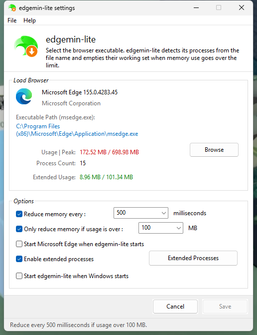
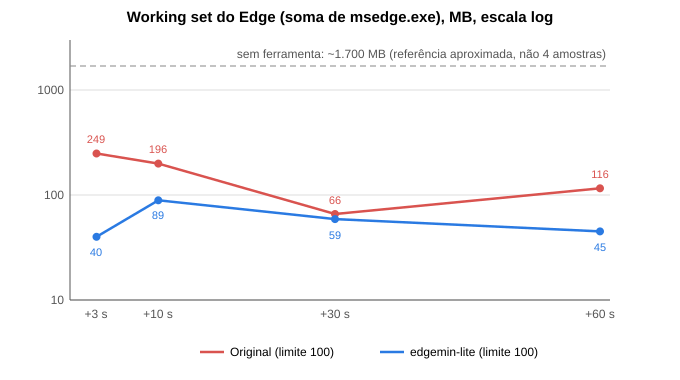
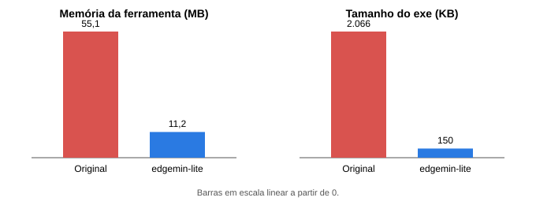

<p align="center">
  
</p>

<h1 align="center">edgemin-lite</h1>

<p align="center">
  A tiny Windows tray app that keeps your browser's RAM footprint low.<br>
  ~330 KB, no installer, no runtime, one dependency-free <code>.exe</code>.
</p>

<p align="center">
  <a href="https://github.com/pendiego/edgemin-lite/releases/latest">Download</a> ·
  <a href="#how-it-works">How it works</a> ·
  <a href="#configuration">Configuration</a> ·
  <a href="#credits">Credits</a>
</p>

<p align="center">
  
</p>

## What it does

Chromium browsers (Edge, Chrome) and Firefox keep a lot of memory in each process's *working set* even for tabs you are not looking at. `edgemin-lite` watches your browser's processes and, when their combined working set goes over a limit you choose, asks Windows to take the idle pages back. The pages stay in RAM's standby list and come back on demand if the browser touches them again.

On the author's machine, with about 15 Edge processes open, the working set dropped from roughly **1.7 GB to 40–90 MB** (single run, idle browser, limit 100 MB; the original Edgemin landed at 66–250 MB):

<p align="center">
  
</p>
<p align="center">
  
</p>

> **Be honest about the trade-off.** This reduces *working set*, not committed memory (private bytes stay about the same). Trimmed pages are soft-faulted back when used, so the first touch of a trimmed tab is measurably slower (a 48 MB read went from ~0.4 ms to ~10 ms in testing). Raise the limit or the interval if you notice stutter.

## How it works

1. **Find.** Every `Boost` milliseconds (default 500) it takes one snapshot of the running processes (`CreateToolhelp32Snapshot`) and picks every process whose file name matches your browser's exe, plus any extra names you list.
2. **Measure.** For each group it opens the processes with the least access needed (`PROCESS_QUERY_LIMITED_INFORMATION | PROCESS_SET_QUOTA`) and sums `WorkingSetSize` through `GetProcessMemoryInfo`.
3. **Trim.** If the group total is above `ReduceLimit` MB (or the limit is disabled), it calls `EmptyWorkingSet` on every process in the group. Processes it cannot open (elevated, exited) are skipped.
4. **Report.** The tray tooltip and the Settings window show current usage and peak. Measurement continues while trimming is paused.

The program is a message-only window with a tray icon. Settings, update checks and downloads never block the trimming loop.

## Usage

- **Tray icon** – right-click (or left-click) for the menu: toggle trimming, run the browser (normal or safe mode), **Settings...**, edit/reload the config file, **Start with Windows**, **Check for updates**, **Exit**.
- **Settings window** – browser picker with live info (name, version, usage | peak, process count), interval and limit, extra processes editor, start options. **Save** enables after the first change and applies immediately.
- **Portable** – put `edgemin-lite.ini` next to the exe and it is used instead of `%APPDATA%`.

## Configuration

`edgemin-lite.ini` (created with defaults on first run, next to the exe if present, else `%APPDATA%\edgemin-lite\`). Both UTF-8 and UTF-16 files are read. An old Rizonesoft `Edgemin.ini` can be dropped in as is; unknown keys are ignored, and saving from the Settings window rewrites only the keys below.

| Section | Key | Meaning | Default |
|---|---|---|---|
| `[Edgemin]` | `BrowserPath` | Browser exe. Its file name is the process name that is trimmed | Edge |
| | `BoostEnabled` | `1`/`0`, trimming on/off | `1` |
| | `Boost` | Interval in ms (minimum 100) | `500` |
| | `LimitEnabled` / `ReduceLimit` | Only trim when the group total is above N MB | `1` / `10` |
| | `StartBrowser` | Launch the browser at startup | `0` |
| | `EnableExtendedProcs` / `ExtendedProcs` | Extra exe names to trim, comma separated | `1` / empty |
| `[Safemode]` | `exe=arguments` | Arguments for **Run in safe mode** | Edge, Chrome, Firefox, Waterfox |
| `[Update]` | `Repo` | GitHub `owner/name` to check; empty disables updates | `pendiego/edgemin-lite` |
| | `Check` | `1` = check at startup and every 24 h | `1` |

## Updates

A newer GitHub release shows a tray balloon and an **Update to vX...** menu item. **Check for updates** checks on demand. Nothing is installed without your confirmation.

The updater downloads the release asset named `edgemin-lite.exe` over HTTPS and compares its SHA-256 with the `digest` GitHub publishes for that asset. A missing or mismatching hash aborts the update. The running exe is renamed to `.old`, the new one takes its place and starts; if it cannot start, the old one is restored. There is **no code signing**: trust rests on HTTPS to GitHub plus that hash. The exe's folder must be writable.

For maintainers: bump `version` in `Cargo.toml`, build, tag `vX.Y.Z`, and attach `edgemin-lite.exe` to the release.

## Build

Windows, Rust stable, **MSVC toolchain** (`build.rs` embeds `app.manifest` for themed controls and DPI awareness).

```
cargo test
cargo build --release   # target\release\edgemin-lite.exe
```

The only dependency is [`windows-sys`](https://crates.io/crates/windows-sys). Update downloads use WinHTTP and BCrypt from Windows itself.

## Credits

- **[Rizonesoft Edgemin](https://www.rizonesoft.com/)** by Rizonesoft is the inspiration. `edgemin-lite` re-implements its core behavior (periodic `EmptyWorkingSet` on the browser's processes, INI keys, tray workflow, and a settings window with a similar layout) as a small independent program. **No Edgemin code is used**; behavior was studied by observing the app and its configuration. This project is not affiliated with or endorsed by Rizonesoft.
- **Icon** – `assets/edgemin-lite.ico` and the logo above are a recolored, modified derivative of the Edgemin icon, **© Rizonesoft**. The MIT license below does **not** cover it. Replace it before redistributing.
- **[windows-sys](https://github.com/microsoft/windows-rs)** by Microsoft (MIT / Apache-2.0).

## License

Code: [MIT](LICENSE) © 2026 Diego. The icon is excluded, see Credits.
